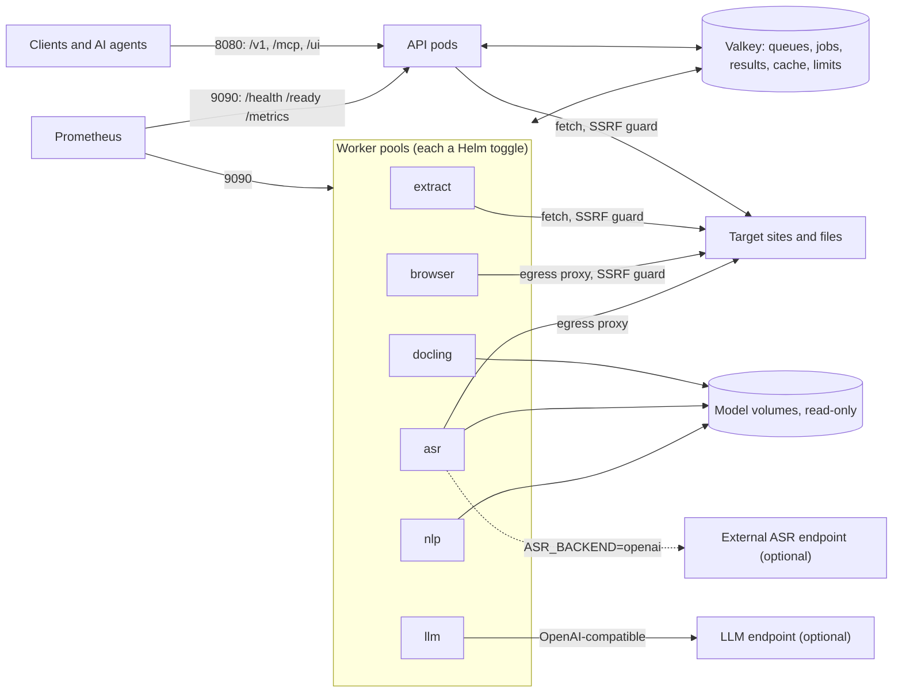

# Hand-over

This document answers the hand-over checklist of the ops guide (section 6) item by item, in the
guide's order, and its section 7 on maintenance and lifecycle. Each answer names the file,
setting or workflow that delivers it and links to the material; it does not repeat it. The
checklist items are quoted in German, as the guide writes them.

The service is a prototype of a private project: no version is tagged yet (see
[Maintenance and lifecycle](#maintenance-and-lifecycle)).

## Architecture overview

Stateless API pods answer fast extractions inline and hand slow work (browser renders, OCR,
transcriptions, PII handling, LLM calls, batches, site crawls) to worker pools through a fair job
queue in Valkey. Every pod is one process type from one of five images; all shared state (jobs,
results, cache, rate limits, per-host outbound state, fingerprints) lives in Valkey with TTLs
(the queue lists have none: they empty as workers claim their items).
Workers that need a model read it from a read-only volume; no image holds models or data.

- **API pods** (image `text-extraction`): the REST API, the optional MCP endpoint and playground,
  fast-mode extraction (Trafilatura, MarkItDown in child processes), the job API.
- **extract**: batch and site-crawl items in fast mode (same image as the API).
- **browser** (image `text-extraction-browser`): Chromium renders, screenshots, unblock mode.
- **docling** (image `text-extraction-docling`): OCR with Docling and Tesseract.
- **asr** (image `text-extraction-asr`): transcription with faster-whisper on the CPU, or an
  external endpoint.
- **nlp** (image `text-extraction-nlp`): PII handling with Presidio and spaCy.
- **llm** (image `text-extraction`): structured output with an LLM, semantic chunking, image
  descriptions.

Data flow of a request: the API pod checks the key and the rate limit, runs the compliance checks
(robots.txt, TDM opt-out) and fetches the page within the per-host outbound limits. A result that
needs more work (a browser render, OCR, PII, the LLM) becomes a job item of that pool, and the
API pod waits for it up to a bound. When the bound runs out, PII and LLM work answers 202 with the
job; a browser render or OCR falls back to the fast result (warning `browser_unavailable` or
`ocr_unavailable`), unless the caller sent `wait_seconds`, which turns any slow request into a 202
job. Batches and crawls are jobs from the start. The full picture is in
[architecture.md, Overview](architecture.md#overview) and
[Jobs and the fair queue](architecture.md#jobs-and-the-fair-queue).

## 1. Repository and CI

*Repo-Link und CI-Pipeline, die getaggte, schlanke Images ohne Daten baut*

- Repository: <https://github.com/janschachtschabel/text-extraction> (public, Apache-2.0).
- CI: [`.github/workflows/ci.yml`](../.github/workflows/ci.yml) runs ruff, mypy (strict), pytest,
  the licence gates (no AGPL or GPL dependency), `helm lint --strict` over the toggle combinations
  and the render checks of [`deploy/helm/test.sh`](../deploy/helm/test.sh) on pull requests and
  pushes to `main`, plus a weekly run with the default model sizes.
- Images: [`.github/workflows/image.yml`](../.github/workflows/image.yml) builds the five images
  from one multi-stage [`Dockerfile`](../Dockerfile) (`python:3.13-slim`, non-root uid 10001,
  tini as PID 1, no models, no data) and checks each one. Pull requests push nothing; pushes to
  `main` publish `latest` and `sha-<short>` (staging only); a Git tag `vX.Y.Z` publishes `X.Y.Z`
  and `X.Y` to `ghcr.io/janschachtschabel/text-extraction`, `-browser`, `-docling`, `-asr` and
  `-nlp`.
- Further workflows: [`e2e.yml`](../.github/workflows/e2e.yml) (a 1,000-URL batch against a local
  site farm), [`live.yml`](../.github/workflows/live.yml) (the regression on real URLs, see
  item 4), [`load.yml`](../.github/workflows/load.yml) (the load test behind items 4 and 9).

## 2. OpenAPI

*Pfad zur OpenAPI-Spec, Anzeigename und Beschreibungstext für Endnutzende*

- Path: `/openapi.json` on the public port 8080; the interactive docs are `/docs` and `/redoc`.
  The internal port serves none of them (`tests/test_app.py`).
- Display name: `Text Extraction API`; the version is the release version.
- Description: "Turns web pages, files, audio and video into clean text or Markdown, with a fast
  HTTP mode and a browser mode." Both are set in `src/text_extraction/app.py`.
- `/mcp` and `/ui` are not part of the spec; the endpoints are listed in
  [architecture.md, Public API](architecture.md#public-api-port-8080).

## 3. Ports and hidden paths

*Liste auszublendender Pfade bzw. Port-Aufteilung (öffentlich / intern)*

- Public: port 8080, the Service `<release>-text-extraction` and the Ingress (`/v1/...`, the
  OpenAPI paths, and `/mcp` and `/ui` while switched on).
- Internal: port 9090 with `/health` (liveness), `/ready` (readiness) and `/metrics`, on the API
  pods and on every worker, through the cluster-internal Services `...-internal`. They are not in
  the spec and not reachable on 8080. Workers serve only 9090.
- Details and probe semantics:
  [configuration.md, Ports and probes](configuration.md#ports-and-probes). `mcp.enabled` and
  `ui.enabled` are off by default
  ([Helm chart, MCP and playground](../deploy/helm/text-extraction/README.md#mcp-and-playground)).

## 4. Headers, content types, response times, job endpoints

*Besondere Header, Content-Types, erwartete Antwortzeiten, ggf. asynchrone Job-Endpunkte*

- Headers: `Authorization: Bearer <key>`, `x-client-trace-id` and the B3 headers, and the
  caller's keys `X-LLM-Api-Key` and `X-ASR-Api-Key` (secrets, never logged). Responses carry no
  custom headers besides `Retry-After` on 429 and `WWW-Authenticate` on 401:
  [configuration.md, Headers](configuration.md#headers).
- Content types: JSON everywhere, plus `multipart/form-data` (uploads), `image/png` (screenshot
  download), and for the playground `text/html`, `application/x-www-form-urlencoded`, CSS and
  JavaScript. `/mcp` answers JSON only (no server-sent events):
  [architecture.md, Public API](architecture.md#public-api-port-8080).
- Response envelope: every extraction answer has `status` (`success`, `partial`, `failed`),
  `error.code`, `error.retryable`, `upstream_status`, `mode_used` and `timings`. A failed target
  is 200 with `status: failed`; 5xx only for the service's own faults:
  [architecture.md, Result envelope and errors](architecture.md#result-envelope-and-errors).
- Service-side processing times, measured by the load test on a 4-vCPU runner (run
  [41194228955](https://github.com/janschachtschabel/text-extraction/actions/runs/41194228955),
  2026-10-31, commit `b7499cc`), p50 / p95:

  | Request | At once | p50 / p95 |
  | --- | ---: | --- |
  | `POST /v1/extract`, fast mode | 10 / 30 | 395 / 615 ms, 531 / 778 ms |
  | the same in browser mode | 10 | 3,928 / 4,925 ms |
  | `POST /v1/extract/file`, documents (MarkItDown) | 5 | 2,092 / 2,813 ms |
  | the same, a scanned PDF with OCR (Docling) | 2 | 11,974 / 13,984 ms |
  | `POST /v1/extract` with `pii: mask` | 10 | 1,332 / 1,875 ms |
  | `POST /v1/structured` with selectors | 10 | 370 / 609 ms |
  | `POST /v1/batch` of 1,000 URLs, until done | 1 | 50 s |

  The load-test conditions differ from production: every target was a page of a local site farm
  on one host with no network latency, and the load stack switched off the per-host spacing
  (`OUTBOUND_MIN_DELAY_MS=0`), allowed 64 requests per host at once
  (`OUTBOUND_MAX_CONCURRENCY_PER_HOST=64`) and switched off the inbound rate limit
  (`RATE_LIMIT_ENABLED=false`) (`deploy/load/compose.load.yml`). The times above are therefore the
  service's own processing, without a real site's fetch time. Under the defaults:
  - a batch's duration per host is at least the larger of (URLs on that host) ×
    `OUTBOUND_MIN_DELAY_MS` and (URLs on that host) × the site's fetch time /
    `OUTBOUND_MAX_CONCURRENCY_PER_HOST`, because the spacing applies between the starts of two
    requests to one host across all pods, and at most 2 run at once. A 1,000-URL batch on one host
    takes at least 1,000 × 1 s = 1,000 s, about 17 minutes (25 minutes with a 3 s fetch: 1,000 ×
    3 s / 2), not the 50 s above; a robots.txt `Crawl-delay` stretches it further (up to
    `OUTBOUND_MAX_CRAWL_DELAY_SECONDS`, 10 s per request). Hosts run in parallel, so a batch over
    many hosts is bounded by its largest host;
  - one key may send `RATE_LIMIT_PER_MINUTE` (60) requests a minute, so the 300 and 900 requests
    of the fast scenarios need a key with a higher `rate_limit_per_minute`.

  Every scenario, with run 4 for comparison, is in
  [configuration.md, Resource baselines](configuration.md#resource-baselines).
- Longest wait of a sync request without `wait_seconds`, from the defaults
  ([configuration.md, Response times](configuration.md#response-times)):

  | Request | Longest wait |
  | --- | --- |
  | fast mode | 25 s (`EXTRACT_TIMEOUT_SECONDS`) |
  | `auto` that escalates to a browser render | 70 s: 25 + `BROWSER_QUEUE_WAIT_SECONDS` (10) + `BROWSER_TIMEOUT_SECONDS` (30) + 5 |
  | the same in unblock mode | 100 s: the render deadline is `BROWSER_UNBLOCK_TIMEOUT_SECONDS` (60) |
  | a document that needs OCR | about 45 s: 25 + `DOCLING_SYNC_WAIT_SECONDS` (20) |
  | with `pii` | + `PII_SYNC_WAIT_SECONDS` (20) |
  | with LLM work (`structured` with the LLM, `semantic` chunking, `describe_images`) | + `LLM_SYNC_WAIT_SECONDS` (30) |

  The waits add up along a request's hops: a browser render with `pii` and LLM work waits up to
  120 s, in unblock mode 150 s. These sums occur only when the pod cannot hand the request over
  to a job (`EXTRACT_MAX_BACKGROUND` reached, or the Valkey memory guard high). Normally a
  request with `pii` or LLM work answers 202 with its job once its implicit wait runs out (20 s
  for `pii`, 30 s for LLM work, the largest default that applies). When a wait for the nlp or
  llm workers runs out, the request answers 202 with its job. A browser wait that runs out
  answers the fast result in `auto` (warning `browser_unavailable`; `mode: browser` answers
  `timeout`, retryable), an OCR wait the text layer (warning `ocr_unavailable`). With
  `wait_seconds` (at most 60) any slower request answers 202 after that time instead
  (`POST /v1/extract/file` defaults to 25). **Give the ingress, and any gateway in front, a read
  timeout of at least 120 s** (150 s with unblock mode and requests that combine it with `pii`
  and LLM work); the
  [example values](../deploy/helm/text-extraction/values-production.example.yaml) set 120 s for
  ingress-nginx.
- Against real sites the live regression
  ([`live.yml`](../.github/workflows/live.yml), gate: 200 WLO URLs in `auto`, at least 80 % usable
  text) measured 82.5 % on 2026-10-31 ([packages.md, Status](packages.md#status)).
- Job endpoints: `POST /v1/batch` and `POST /v1/site-structure` answer 202 with a job;
  `POST /v1/extract`, `/v1/extract/file`, `/v1/screenshot`, `/v1/structured` and `/v1/chunk`
  hand a slow extraction over to a job after `wait_seconds` (202). The job is read with
  `GET /v1/jobs/{id}` (status, progress, paged results), its screenshot with
  `GET /v1/jobs/{id}/artifacts/screenshot.png`, and cancelled with `DELETE /v1/jobs/{id}`:
  [architecture.md, Public API](architecture.md#public-api-port-8080) and
  [Jobs and the fair queue](architecture.md#jobs-and-the-fair-queue).

## 5. Auth and LLM keys

*Mit B-API: Modell-Routing, Bedarf an virtuellem Key, Berechtigungen. Ohne B-API: Env-Variablen für LLM-Keys und Auth, Auth-Konzept*

The service runs without B-API today and is prepared for it.

- Auth concept: `AUTH_MODE=api_key` (default) requires `Authorization: Bearer <key>` on every
  public request. `AUTH_MODE=none` turns authentication off and makes every caller an `admin`:
  anyone who reaches port 8080 may use `compliance: ignore`, JavaScript actions (`evaluate`) and
  unblock mode, and read and cancel every job. Keys come from the secret `API_KEYS` as SHA-256
  hashes with a name, a role (`user` or `admin`) and an optional per-key rate limit. Users see
  their own jobs; admins may see all jobs and use `compliance: ignore`, JavaScript actions and
  unblock mode:
  [architecture.md, Auth](architecture.md#auth),
  [configuration.md, Secrets](configuration.md#secrets).
- LLM: `LLM_ENABLED`, `LLM_BASE_URL` (any OpenAI-compatible endpoint), `LLM_MODEL`,
  `LLM_EMBEDDING_MODEL`, `LLM_VISION_MODEL` and the secret `LLM_API_KEY`:
  [configuration.md, LLM](configuration.md#llm). The models are chosen by the operator, never per
  request; that is all the model routing there is.
- B-API readiness of the auth: behind a gateway such as B-API, keep `AUTH_MODE=api_key` and
  give the gateway a key of role `user` (or one per consumer, so that the per-key rate limits and
  job ownership tell them apart). Do not switch to `none` behind a gateway: every consumer of the
  gateway would be an admin. `none` belongs only where every caller may be an admin, for example
  a local stack. Admin keys stay with the operator.
- B-API readiness of the LLM: a caller's `X-LLM-Api-Key` header wins over `LLM_API_KEY`, so a
  B-API virtual key can be passed per request, and `LLM_BASE_URL` can point at B-API's
  OpenAI-compatible endpoint. Nothing B-API-specific is built. The same pattern holds for the
  external ASR endpoint (`X-ASR-Api-Key` over `ASR_EXTERNAL_API_KEY`).

## 6. Metrics and alerts

*Prometheus-Endpunkt, Applikationsmetriken und Alarmregeln*

- Endpoint: `/metrics` on port 9090 of every pod; the ServiceMonitor
  (`metrics.serviceMonitor.enabled`) scrapes the internal Services of the API pods and of every
  worker pool.
- Metrics: the HTTP metrics of prometheus-fastapi-instrumentator plus the application metrics
  (queue gauges per pool, jobs, items, extractions, browser, documents, media, ASR, LLM calls and
  tokens, site jobs, MCP tools, the event-loop lag):
  [configuration.md, Metrics](configuration.md#metrics).
  Query the queue gauges with `max()` over the API pods.
- Alert rules: the PrometheusRule (`metrics.prometheusRule.enabled`) with service down, 5xx share,
  Valkey memory, queue backlog and workers down per pool, job item failures and stale queue
  metrics: [Helm chart, Alerts](../deploy/helm/text-extraction/README.md#alerts).

## 7. Logs and trace headers

*Log-Format und Durchreichen von x-client-trace-id*

- Format: one JSON object per line on stdout (structlog), with `timestamp` (ISO 8601, UTC),
  `level`, `logger` and `event`; `LOG_FORMAT=console` switches to plain text for local work,
  `LOG_LEVEL` sets the level
  ([configuration.md, Environment variables](configuration.md#environment-variables)).
  Each request writes one access line (`event: request`, method, path, status, `duration_ms`).
  Query strings and secrets are never logged.
- Trace headers: `x-client-trace-id` becomes `trace_id` on every log line of the request and in
  the response envelope (without one the service generates an id); the B3 headers (`b3`,
  `x-b3-traceid`, `x-b3-spanid`, `x-b3-parentspanid`, `x-b3-sampled`) are logged on every line.
  A job keeps the trace id of the request that created it, so its items log under it on the
  workers. Trace headers are never forwarded to target sites:
  [configuration.md, Headers](configuration.md#headers).

## 8. State and horizontal scaling

*Aussage zu Zustand und horizontaler Skalierbarkeit, kurze Architekturübersicht*

- The pods are stateless: everything shared is in Valkey; a pod's local files are scratch space
  (temporary media and browser files) that nothing needs after the pod. Any pod can be removed;
  a job item whose worker dies runs again on another worker once its lease expires
  (`JOB_ITEM_MAX_ATTEMPTS`).
- API pods scale horizontally behind the Service (`replicaCount`, or `autoscaling.*` on CPU).
  Every worker pool scales on its own: `workers.<pool>.replicaCount`, KEDA on the pool's queue
  backlog or an HPA on CPU (`workers.<pool>.autoscaling.*`). The KEDA thresholds are not measured
  yet (the load test ran one pod per pool); tune them from the queue gauges. Per-host outbound
  limits and the fair queue hold across all pods, because they live in Valkey.
- The HPA's CPU target (`targetCPUUtilizationPercentage`, 70 %) is a share of the pod's CPU
  request, and the requests are now the measured ones of item 9: an API pod at 1400m scales out
  only at about 0.98 cores on average, more than the load test's 30 clients took (0.59 to
  0.77 cores). For an earlier scale-out, lower the request (item 9) or the target.
- Exceptions to plain scaling: ASR transcriptions in flight restart elsewhere when their pod is
  removed, so prefer fixed ASR replicas for steady load
  ([Helm chart, ASR
  workers](../deploy/helm/text-extraction/README.md#asr-workers-and-the-models-volume));
  the in-chart Valkey is a single replica.
- The short architecture overview is [at the top of this document](#architecture-overview).

## 9. Resource baseline

*Ressourcen-Baseline (RAM, CPU, Storage)*

- RAM and CPU: measured with `docker stats` under the load profile, each scenario alone, in two
  runs on 2026-10-31; method, per-scenario numbers and the sizing rule are in
  [configuration.md, Resource baselines](configuration.md#resource-baselines). The Helm defaults
  and the [example values](../deploy/helm/text-extraction/values-production.example.yaml) carry
  the result:

  | Component | Request (CPU / memory) | Limit (CPU / memory) | Model in RAM (idle MiB) |
  | --- | --- | --- | --- |
  | API pods | 1400m / 832Mi | 3750m / 2560Mi | none |
  | extract workers | 450m / 768Mi | 1750m / 2560Mi | none |
  | browser workers | 750m / 1152Mi | 2250m / 4608Mi | none (Chromium) |
  | docling workers | 2250m / 1600Mi | 5500m / 8Gi | 756 to 1243 |
  | asr workers (`large-v3-turbo`) | 3050m / 1408Mi | 5500m / 6Gi | 1146 to 1192 |
  | nlp workers (`lg`) | 750m / 1728Mi | 2 / 3Gi | 1675 to 1690 |
  | llm workers | 150m / 256Mi | 750m / 1Gi | none |
  | in-chart Valkey | 500m / 1280Mi | 500m / 1280Mi | none |

  The CPU requests reflect the heaviest scenario of the load profile for each component (for
  example 10 OCR PDFs or 10 transcriptions back to back) and can be lowered for light traffic.
  The memory limits stay: they back the address-space budgets of the child processes. ASR
  `small` and PII `md` were not measured. No GPU is needed.
- Storage, per volume:

  | Volume | Size | Growth |
  | --- | --- | --- |
  | Docling models (PVC, ReadWriteMany) | 5Gi (about 335 MiB used) | none; only a model change |
  | ASR models (PVC, ReadWriteMany) | 4Gi (`large-v3-turbo` 1,547 MiB, `small` 464 MiB) | none; only a model change |
  | NLP models (PVC, ReadWriteMany) | 3Gi (`lg` about 1 GB, `md` about 115 MB) | none; only a model change |
  | Valkey | memory: `valkey.maxmemory` (768mb); optional PVC of 1Gi (`valkey.persistence`) | bounded by maxmemory; every key but the queue lists has a TTL |
  | ASR scratch (emptyDir) | 2Gi (`workers.asr.scratch.sizeLimit`) | bounded |
  | browser `/tmp` (emptyDir) | 2Gi (`workers.browser.tmpSizeLimit`) | bounded |

## 10. Database and switchable components

*Datenbankwahl (kein SQLite in Produktion) und abschaltbare Komponenten im Helm-Chart (DB, Redis, Worker)*

- Database: Valkey (Redis protocol, Valkey 7.2+ or Redis 7.0+) with `noeviction`; no SQLite and
  no other database. The chart can run its own single-replica Valkey with a password
  (`valkey.enabled`, default) or use an external one (`valkey.enabled: false` plus
  `externalValkey.url` or `externalValkey.existingSecret`):
  [Helm chart, Configuration](../deploy/helm/text-extraction/README.md#configuration).
- Switchable in Helm: `valkey.enabled`, the worker pools `workers.extract`, `.browser` (with
  `.unblock`), `.docling`, `.asr`, `.nlp` and `.llm` (`enabled` each), `jobs.enabled`,
  `mcp.enabled`, `ui.enabled`, `ingress.enabled`, `autoscaling.enabled` and the scalers per pool,
  `metrics.serviceMonitor.enabled`, `metrics.prometheusRule.enabled` and
  `networkPolicy.enabled`:
  [Helm chart, What it creates](../deploy/helm/text-extraction/README.md#what-it-creates).
- Not built: an S3-compatible store. Screenshots and results stay in Valkey for their TTLs
  (`ARTIFACT_TTL_SECONDS`, `JOB_TTL_SECONDS`).

## 11. Large data

*Datenbereitstellung für große Daten (Quelle, Volume-Größe)*

The only large data are the models of three worker pools; the images hold none, and the service
keeps no other data set.

- Source: each pool's manifest names pinned URLs with size and SHA-256:
  `src/text_extraction/documents/models.toml` (Docling from `huggingface.co`, Tesseract from
  `raw.githubusercontent.com`), `src/text_extraction/media/models.toml` (Whisper models from
  `huggingface.co`) and `src/text_extraction/pii/models.toml` (spaCy from the
  explosion/spacy-models releases on `github.com`).
- Provision: an init container (default) or a Helm hook Job (`models.downloadMode: job`) fills
  the volume once and checks every file; the workers mount it read-only. Air-gapped: fill a
  volume elsewhere and set `models.persistence.existingClaim` and `models.download: false`.
- Sizes: see item 9. Details per pool:
  [Docling](../deploy/helm/text-extraction/README.md#docling-workers-and-the-models-volume),
  [ASR](../deploy/helm/text-extraction/README.md#asr-workers-and-the-models-volume),
  [NLP](../deploy/helm/text-extraction/README.md#nlp-workers-and-the-models-volume).

## 12. Settings, values, secrets, Dockerfile and compose

*Env-Variablen mit Defaults, Beispiel-Values-YAML, Liste der Secrets, Dockerfile und docker-compose.yml als Referenz*

- Environment variables with their defaults:
  [configuration.md](configuration.md#environment-variables) (every setting, pinned by
  `tests/test_configuration_doc.py`), and the Helm values in the
  [chart README](../deploy/helm/text-extraction/README.md#values).
- Example values:
  [`values-production.example.yaml`](../deploy/helm/text-extraction/values-production.example.yaml)
  (external Valkey, secrets from existing Secrets, pinned SemVer tags, the measured resources,
  rules and ServiceMonitor on, MCP and UI off; `deploy/helm/test.sh` lints and renders it).
- Secrets, kept apart from the ConfigMap: `API_KEYS` (or `API_KEYS_FILE`), `VALKEY_PASSWORD`
  (in-chart Valkey) or a `VALKEY_URL` with a password, `LLM_API_KEY`, `ASR_EXTERNAL_API_KEY` and
  `PII_HASH_KEY`; callers may send `X-LLM-Api-Key` and `X-ASR-Api-Key`:
  [configuration.md, Secrets](configuration.md#secrets).
- Reference only: the [`Dockerfile`](../Dockerfile) (five targets), the
  [`docker-compose.yml`](../docker-compose.yml) with [`.env.example`](../.env.example) for a
  local stack. Resources, scaling and secrets for a deployment come from the Helm chart.

## 13. Costs

*Kosteninformationen (z. B. erwartete LLM-Kosten, externe APIs)*

The notes give formulas with measured inputs and the prices as parameters, not a fixed sum.

- **External APIs:** none by default. Two are optional and billed by their provider:
  - the LLM endpoint (`LLM_ENABLED`, `LLM_BASE_URL`, `LLM_MODEL`, `LLM_EMBEDDING_MODEL`,
    `LLM_VISION_MODEL`, `LLM_API_KEY` or the caller's `X-LLM-Api-Key`);
  - the external ASR endpoint (`ASR_BACKEND=openai`, `ASR_EXTERNAL_BASE_URL`,
    `ASR_EXTERNAL_MODEL`, `ASR_EXTERNAL_API_KEY` or the caller's `X-ASR-Api-Key`), usually
    billed by the audio sent; `text_extraction_asr_audio_seconds_total{backend="openai"}` counts
    its seconds.

  The model downloads (item 11) are free and happen once.
- **LLM**, from the load test's fake endpoint (runs
  [41190110782](https://github.com/janschachtschabel/text-extraction/actions/runs/41190110782) and
  [41194228955](https://github.com/janschachtschabel/text-extraction/actions/runs/41194228955),
  identical counts). Tokens are approximated as UTF-8 bytes / 4 of the request bodies, rounded
  down as the harness's table prints them:

  | Request | LLM calls | Prompt tokens per call | Completion tokens per call |
  | --- | ---: | ---: | ---: |
  | `POST /v1/structured`, strategy `llm`, a farm page | 1 chat call | 1,290 | 8 (1,750 bytes / 50 / 4 = 8.75, rounded down: the fake's minimal answer) |
  | `POST /v1/chunk`, `semantic` | 1 embeddings call | 968 | none |

  Cost per request (one page) = calls × (prompt tokens × P_in + completion tokens × P_out) /
  1,000,000, with P_in and P_out the chat model's prices per 1M input and output tokens. An
  embeddings call is billed on its input only: tokens × the embedding model's price per 1M
  tokens / 1,000,000. A real model answers longer than the fake's 8 tokens: the completion grows
  with the caller's schema. The prompt grows with the page, up to `LLM_MAX_INPUT_TOKENS`
  (32,000) of content plus the instructions and the schema; the answer is capped by
  `LLM_MAX_TOKENS` (4,096); an invalid answer gets one repair call. `describe_images` adds one
  vision call per image (5 by default, at most 20; not measured). `learn_selectors` asks
  the LLM for selectors that later requests of the same key and host reuse without it, for
  `SELECTOR_LEARN_TTL_SECONDS`. No real-model run was made. In operation,
  `text_extraction_llm_tokens_total{kind}` counts the tokens the endpoint reports.
- **ASR** (local backend, `large-v3-turbo`, int8, `ASR_THREADS` 4): CPU seconds per audio minute =
  the asr worker's CPU mean × the scenario window / the audio transcribed. The scenario `asr-10`
  sends 10 clips of 30.0 s (`tests/media/corpus/speech_de.ogg`), 5.0 audio minutes:

  | Run | Window | CPU mean | CPU seconds | CPU seconds per audio minute |
  | --- | ---: | ---: | ---: | ---: |
  | [41190110782](https://github.com/janschachtschabel/text-extraction/actions/runs/41190110782) | 169 s | 294.0 % | 497 | 99 |
  | [41194228955](https://github.com/janschachtschabel/text-extraction/actions/runs/41194228955) | 298 s | 301.6 % | 899 | 180 |

  So one audio hour costs 1.7 to 3.0 core-hours (runner speed varies) × the price per core-hour.
  ASR `small` was not measured.
- **Compute:** the resources of item 9 × the replicas × the price of the cluster's CPU and memory.

## 14. Contact

*Ansprechperson für Rückfragen und Updates*

Jan Schachtschabel, as a private person: this is a private project. Questions and update requests
go to the repository's [issues](https://github.com/janschachtschabel/text-extraction/issues).

## Maintenance and lifecycle

*Section 7 of the ops guide: who triggers and carries out updates, and, for a prototype, whether
and when permanent operation is decided.*

**Updates.** Jan Schachtschabel triggers and carries out updates of dependencies, security
patches and models.

- Dependencies: [Dependabot](../.github/dependabot.yml) opens weekly grouped pull requests for
  the uv lock, the GitHub Actions, the Docker base images and the compose file's Valkey image
  (minor and patch updates together, a major update alone, at most 5 open per ecosystem). A
  14-day cooldown gives each release two weeks before it is proposed (Dependabot's security
  updates, where the repository enables them, skip it). Jan, or Claude in his project, merges
  them after green CI.
- Security patches of the images: the base images arrive through Dependabot; Google Chrome in the
  browser image is the stable release of the build day, so the next release picks up its
  patches.
- Model changes: the Docling, Whisper and spaCy models are pinned with SHA-256 in their
  manifests (item 11); a change is a code change and a release, and the init container downloads
  the new files. `ASR_MODEL` (`workers.asr.model`) and `PII_MODEL_SIZE`
  (`workers.nlp.modelSize`) choose between the pinned models. The LLM models are the operator's
  settings (`workers.llm.model` and the others).

**Releases and rollback.**

- [`CHANGELOG.md`](../CHANGELOG.md) records each release (Keep a Changelog). The version is the
  same in `pyproject.toml`, `src/text_extraction/__init__.py` and the chart's `Chart.yaml`
  (`version`, `appVersion`); `tests/test_release.py` checks it.
- A release is the Git tag `vX.Y.Z` on `main`. The image workflow then publishes `X.Y.Z` and
  `X.Y` for all five images; a deployment pins `image.tag` (and the workers' image tags) to
  `X.Y.Z`, as the example values do.
- Rollback: `helm rollback <release> <revision>`, or `helm upgrade` with the previous tag.
- No version is tagged yet. The first will be `v0.1.0`, a prototype, after package 12 (UI
  languages, unblock option, bilingual docs; [packages.md](packages.md#status)). Package 11 is
  merged without a tag.

**Prototype status.** The service is a prototype. No date is set for a decision on permanent
operation; Jan Schachtschabel decides. What permanent operation adds:

- running costs: the compute of item 9 for the replicas chosen, and the LLM and ASR costs of
  item 13 for the traffic;
- maintenance effort: the weekly Dependabot pull requests, the releases, and following the live
  regression (weekly run of [`live.yml`](../.github/workflows/live.yml));
- open checks:
  - the full WLO regression on 4,000 URLs: planned, not run. Start it with `live.yml`
    (`url_set: wlo_4000`), once per `mode` (`auto`, `fast`, `browser`), one run after another
    at the normal per-host limits (tests/live/README.md), and compare with the baselines of
    2026-09-28 (fast 68 %, browser 80 %);
  - ASR `small` and PII `md` under load: not measured (a manual `load.yml` run with
    `asr_model: small` and `pii_model_size: md`);
  - a cost run against a real LLM: not made;
  - the KEDA thresholds: not measured;
  - the ASR self-check failed once at start-up in load run 3
    ([41189314063](https://github.com/janschachtschabel/text-extraction/actions/runs/41189314063))
    and passed in the runs after it; the cause is not known yet.
